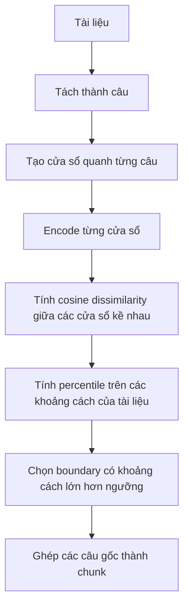

# Hiểu baseline LlamaIndex SemanticSplitter và đối chiếu với project

> Cập nhật: baseline mới là [Max–Min (2025)](MAXMIN.md), đã có module độc lập.
> Tài liệu và kết quả bên dưới mô tả LlamaIndex cũ. Pipeline RAG comparison chưa
> chuyển baseline trong task này; không diễn giải kết quả cũ thành điểm Max–Min.

Tài liệu này giải thích baseline đang được dùng trong bài tập **Vietnamese Semantic Chunking for RAG**. Phần thuật toán được đối chiếu trực tiếp với mã nguồn `llama-index-core==0.14.25` đã cài trong `venv`; phần dữ liệu minh họa được kiểm tra từ tài liệu chính thức ngày 27/10/2026.

**Nhận định:** project đang đi đúng hướng về bài toán và cách chọn baseline: cùng chia tài liệu thành các đoạn phục vụ truy xuất, nhưng bổ sung tiêu chí độ dài và liên kết tiếng Việt. Hiện đã có kết quả retrieval trên 16 câu hỏi pilot; tập phát triển nhỏ này chưa chứng minh được hiệu quả tổng quát của phương pháp hay của từng thành phần.

## 1. Baseline này thực chất là gì?

`SemanticSplitterNodeParser` là một thuật toán chia văn bản trong thư viện LlamaIndex. Nó sử dụng một embedding model có sẵn để biểu diễn ngữ nghĩa, rồi áp dụng quy tắc chọn điểm cắt. Khi chạy chunker, không có bước huấn luyện một mô hình dự đoán boundary riêng.

Cần phân biệt:

| Thành phần | Vai trò |
|---|---|
| LlamaIndex | Framework cung cấp các thành phần xây dựng ứng dụng dữ liệu/RAG |
| SemanticSplitterNodeParser | Thành phần quyết định chia tài liệu ở đâu |
| Embedding model | Chuyển văn bản thành vector để đo mức độ gần nhau về ngữ nghĩa |
| Retriever | Tìm các chunk phù hợp với câu hỏi sau khi đã chia tài liệu |
| LLM sinh câu trả lời | Bước phía sau retrieval; không cần để chạy chunker |

Vì vậy, tên baseline trong báo cáo nên là **LlamaIndex SemanticSplitter với multilingual MiniLM**, không gọi nó là một mô hình được huấn luyện trên dataset của nhóm.

## 2. “Dữ liệu của người ta” là dữ liệu nào?

### Dữ liệu trong ví dụ chính thức

Notebook chính thức tải một bài luận tiếng Anh của **Paul Graham**, lưu thành `pg_essay.txt`, đọc bằng `SimpleDirectoryReader`, rồi chia thành các node. Ví dụ sử dụng `OpenAIEmbedding()`, cấu hình buffer 1 và percentile 95, đối chiếu với `SentenceSplitter(chunk_size=512)`, sau đó xây dựng query engine và minh họa truy vấn. Đây là dữ liệu demo; notebook không cung cấp bộ nhãn boundary, dependency tiếng Việt và gold evidence tương ứng với benchmark của nhóm. [Nguồn: ví dụ Semantic Chunker](https://developers.llamaindex.ai/python/examples/node_parsers/semantic_chunking/).

Không nên diễn giải bài luận đó là “dataset huấn luyện SemanticSplitter” hoặc lấy ví dụ trả lời câu hỏi trong notebook làm số liệu chứng minh chất lượng trên tiếng Việt.

### Ba loại dữ liệu khác nhau

| Loại dữ liệu | Có vai trò gì? | Trong project này |
|---|---|---|
| Dữ liệu đã dùng để huấn luyện embedding model | Hình thành khả năng biểu diễn ngữ nghĩa của model | Nhóm dùng model có sẵn, không huấn luyện lại; không suy ra dữ liệu huấn luyện từ notebook chunking |
| Tài liệu cần chia | Là đầu vào lúc chạy thuật toán | Văn bản tiếng Việt trong `data/test_case.json` |
| Dữ liệu đánh giá có nhãn | Xác định kết quả nào đúng và đo metric | Nhãn boundary, dependency và 16 câu hỏi pilot có gold evidence retrieval |

**Để so sánh công bằng, không cần dùng lại bài luận tiếng Anh.** Cần cho cả hai phương pháp xử lý cùng corpus tiếng Việt, cùng bộ nhãn và cùng câu hỏi. Ta đang đánh giá khả năng áp dụng thuật toán có sẵn vào bài toán của nhóm.

## 3. Đầu vào và đầu ra

### API của LlamaIndex

Về mặt sử dụng:

```python
documents = [Document(text="Nội dung tài liệu...")]
nodes = splitter.get_nodes_from_documents(documents)
```

Đầu vào là danh sách `Document`, trong đó có nội dung văn bản và có thể có metadata. Đầu ra là danh sách node chứa các đoạn văn bản và thông tin liên quan đến tài liệu. Đây là các đối tượng dữ liệu, không phải câu trả lời cho một câu hỏi.

Các embedding của cửa sổ câu được dùng để chọn boundary. Không nên mặc định rằng chúng chính là embedding cuối cùng của chunk dùng cho retrieval: cửa sổ câu và chunk có thể chứa nội dung khác nhau. Trong benchmark, chunk đầu ra được encode lại để tạo corpus retrieval.

### Interface đã chuẩn hóa trong project

File [baselines/llamaindex_semantic_chunker.py](baselines/llamaindex_semantic_chunker.py) cung cấp:

```python
def llamaindex_semantic_chunk(text: str) -> list[str]:
    ...
```

Adapter chuyển `str → Document → nodes → list[str]`, để đầu ra giống `semantic_chunk(text)` của nhóm. Văn bản rỗng trả về `[]`.

Ví dụ về **hình dạng dữ liệu**, không phải dự đoán đã chạy:

```python
text = "Câu A. Câu B. Câu C. Câu D."

# Nếu thuật toán chọn cắt sau câu B:
chunks = ["Câu A. Câu B.", "Câu C. Câu D."]
```

Câu hỏi, gold evidence và nhãn boundary không được truyền vào chunker để giúp nó chọn điểm cắt. Chúng chỉ phục vụ đánh giá phía sau.

## 4. Thuật toán xử lý từng bước

Phần dưới diễn giải các hàm `_build_sentence_groups`, `_calculate_distances_between_sentence_groups` và `_build_node_chunks` trong [mã nguồn bản đã cài](venv/Lib/site-packages/llama_index/core/node_parser/text/semantic_splitter.py). Có thể đối chiếu thêm [mã nguồn chính thức](https://github.com/run-llama/llama_index/blob/main/llama-index-core/llama_index/core/node_parser/text/semantic_splitter.py); nhánh `main` có thể thay đổi theo thời gian.



### Bước 1 — Tách câu

Giả sử tài liệu được tách thành:

```text
S0, S1, S2, S3, S4
```

Các vị trí có thể cắt là sau S0, S1, S2 và S3. Thuật toán này không tìm điểm cắt bên trong từng câu.

Trong project, baseline dùng chung `split_sentences()` với Ours. Bộ tách hiện tại dựa trên dấu `.`, `?`, `!` đi kèm khoảng trắng; chưa phải một bộ phân tích câu tiếng Việt chuyên sâu. Dùng chung giúp giảm khác biệt tiền xử lý giữa hai phương pháp.

### Bước 2 — Tạo cửa sổ quanh câu

Với `buffer_size=1`, mã nguồn thực tế lấy **một câu trước + câu hiện tại + một câu sau**, nếu các câu đó tồn tại:

| Vị trí | Nội dung cửa sổ được encode |
|---|---|
| 0 | S0 + S1 |
| 1 | S0 + S1 + S2 |
| 2 | S1 + S2 + S3 |
| 3 | S2 + S3 + S4 |
| 4 | S3 + S4 |

Đây là điểm dễ đọc nhầm từ mô tả tham số: buffer 1 không có nghĩa là chỉ encode từng câu đơn lẻ. Theo vòng lặp trong implementation, buffer 0 mới chỉ lấy câu hiện tại.

Các cửa sổ chồng lấn để cung cấp ngữ cảnh khi đo ngữ nghĩa. Điều này **khác với overlap ở chunk đầu ra**: thuật toán ghép các câu gốc thành các chunk không lặp lại câu giữa hai chunk.

### Bước 3 — Encode và tính độ khác biệt

Gọi `W_i` là cửa sổ quanh câu `S_i`, `E_i` là embedding của cửa sổ đó:

```text
E_i = embedding(W_i)
d_i = 1 - cosine_similarity(E_i, E_(i+1))
```

`d_i` là tín hiệu để xét cắt sau `S_i`. Giá trị càng lớn thì hai cửa sổ càng khác nhau theo embedding. Không nên diễn giải `d_i` là xác suất chuyển chủ đề.

Baseline đang dùng cùng model với Ours:

```text
sentence-transformers/paraphrase-multilingual-MiniLM-L12-v2
```

Nhưng **cùng model không đồng nghĩa cùng nội dung được encode**: baseline encode cửa sổ nhiều câu; Ours tính similarity giữa các câu cho công thức semantic drop. Khác biệt này thuộc thuật toán chunking.

### Bước 4 — Lấy percentile của từng tài liệu

Với các khoảng cách của một tài liệu:

```text
D = [d0, d1, ..., d_(n-2)]
threshold = percentile(D, 95)
```

Chọn cắt sau câu `i` khi:

```text
d_i > threshold
```

Phải **lớn hơn**, không phải lớn hơn hoặc bằng. Ngưỡng được tính lại cho từng tài liệu, không phải một ngưỡng cosine cố định cho toàn corpus.

Ví dụ số học tự xây để giải thích, **không phải số đo embedding thực**:

```text
D = [0.10, 0.12, 0.80, 0.11]
percentile 95 theo nội suy tuyến tính = 0.698

Chỉ d2 = 0.80 > 0.698
→ cắt sau S2
→ [S0 S1 S2] và [S3 S4]
```

`95` không có nghĩa là cosine phải đạt 0.95, cũng không có nghĩa chính xác 5% boundary luôn bị cắt. Số lượng khoảng cách, giá trị trùng nhau và phép nội suy ảnh hưởng đến số điểm cắt.

### Bước 5 — Ghép các câu thành chunk

Sau khi có danh sách điểm cắt, thuật toán ghép các câu theo thứ tự gốc. Nó không thêm câu giải thích, không tóm tắt và không sửa nội dung bằng LLM.

Một số hệ quả rút ra từ implementation:

- Không có chính sách min/target/max như 120/180/240 của nhóm.
- Không có quy tắc tường minh nhận biết cặp “nếu–thì” hoặc “tuy–nhưng”. Embedding vẫn có thể giúp giữ chúng cùng nhau, nhưng không đảm bảo.
- Khi chỉ có một khoảng cách, percentile bằng chính khoảng cách đó; điều kiện `>` không chọn điểm cắt.
- Nếu mọi khoảng cách bằng nhau, không có giá trị vượt ngưỡng.
- Nếu có ít nhất hai khoảng cách và cực đại là duy nhất, percentile 95 thấp hơn cực đại; thuật toán sẽ chọn ít nhất điểm cực đại, dù chênh lệch tuyệt đối có thể nhỏ. Vì vậy tài liệu cùng chủ đề vẫn có thể bị chia.

Các nhận xét này giải thích hành vi thuật toán, không chứng minh baseline luôn kém trên dữ liệu thực.

## 5. Đối chiếu với cách nhóm đang làm

| Khía cạnh | Baseline đang tích hợp | Ours hiện tại |
|---|---|---|
| Tách câu | Dùng chung bộ tách câu của project | Bộ tách câu của project |
| Model | Multilingual MiniLM | Cùng instance model |
| Tín hiệu ngữ nghĩa | Độ khác biệt giữa cửa sổ câu kề nhau | Relative semantic drop dựa trên các cặp câu |
| Ngưỡng/chọn điểm cắt | Percentile 95 trong từng tài liệu | Optional cut theo drop; mandatory cut theo điểm tổng hợp |
| Độ dài | Không có chính sách 120/180/240 | Có chính sách ưu tiên độ dài |
| Dependency tiếng Việt | Không có luật tường minh | Điểm phạt từ luật nhận diện cặp từ |
| Overlap đầu ra | Không lặp câu giữa các chunk | Thêm 0–2 câu theo similarity |
| Cách xử lý | Tính các breakpoint của tài liệu rồi ghép chunk | Chọn chunk đầu, tiếp tục với phần còn lại |

Ở đây gọi baseline là “semantic-only” để nói rằng quyết định cắt không thêm các tiêu chí size/dependency của nhóm. Baseline vẫn có ngữ cảnh cửa sổ và ngưỡng percentile; không nên mô tả nó quá đơn giản là chỉ so sánh hai câu rời rạc.

### Những điểm cần mô tả đúng về Ours

Đối chiếu [semantic_chunker.py](src/semantic_chunker.py), [boundary_scorer.py](src/boundary_scorer.py) và [dynamic_overlap.py](src/dynamic_overlap.py):

1. **Dependency protection hiện là cơ chế giảm ưu tiên.** Nhánh mandatory sử dụng điểm phạt `-0.6 * dependency_risk`, không loại bỏ tuyệt đối boundary có dependency. Nhánh optional chọn theo semantic drop và giới hạn min; hiện không kiểm tra dependency risk trực tiếp. Vì vậy không nên viết “thuật toán đảm bảo không bao giờ cắt dependency”.
2. **MAX chưa phải giới hạn cứng của mọi output chunk.** Khi không có boundary hợp lệ, code có thể giữ nguyên phần văn bản; overlap còn được thêm sau khi chọn phần lõi. Output có thể vượt 240.
3. **Đơn vị đếm hiện tại là phần tử phân cách bằng khoảng trắng.** `len(sentence.split())` không phải số subword token của embedding model, cũng không phải số từ đã word-segment chuẩn tiếng Việt.
4. **Overlap bảo toàn ngữ cảnh nhưng tăng dữ liệu lặp.** Retrieval có thể hưởng lợi, nhưng cùng top-k chưa chắc cùng lượng văn bản được đưa vào ngữ cảnh. Khi diễn giải kết quả cần nêu trade-off này.

Tài liệu này chỉ ghi nhận implementation để định vị đóng góp chính xác; không thay đổi thuật toán đang chạy.

## 6. Project có đang đi đúng hướng không?

### Đúng hướng về câu hỏi nghiên cứu

Cả hai phương pháp đều giải cùng một bài toán: nhận tài liệu, tạo các chunk để truy xuất. Baseline có sẵn và đủ gần để kiểm tra liệu bổ sung độ dài, dependency tiếng Việt, relative drop và overlap có mang lại lợi ích hay không.

Đóng góp phù hợp để trình bày là **đề xuất và đánh giá một chiến lược chunking kết hợp tiêu chí cho tiếng Việt**. Chưa nên khẳng định tạo ra embedding model mới hoặc rằng từng thành phần đều cải thiện kết quả.

So sánh với một baseline cho biết hiệu quả của toàn bộ cấu hình Ours so với cấu hình baseline. Muốn tách riêng đóng góp của dependency hoặc overlap thì cần thí nghiệm bỏ từng thành phần; đó là bước bổ sung nếu phạm vi bài tập cho phép.

### Chưa đủ bằng chứng về hiệu quả

Kết quả đang lưu trong [CSV](evaluation/results/chunker_comparison.csv):

| Metric | LlamaIndex | Ours |
|---|---:|---:|
| Precision trên vị trí có nhãn | 0.4000 | 1.0000 |
| Recall trên vị trí có nhãn | 0.4000 | 0.8000 |
| F1 trên vị trí có nhãn | 0.4000 | 0.8889 |
| Dependency violation | 0/3 | 0/3 |
| Retrieval Recall@3 (16 câu hỏi pilot) | 0.7500 | 0.7500 |
| Retrieval Recall@5 (16 câu hỏi pilot) | 0.8125 | 0.9375 |

Không nên gọi bảng này là bằng chứng cuối cùng vì:

- 13 case hiện tại là dữ liệu phát triển đã được dùng trong quá trình xây dựng project.
- Nhãn boundary chưa đầy đủ; evaluator bỏ qua các dự đoán ở vị trí chưa gán nhãn. Đây chưa phải F1 trên toàn bộ boundary.
- Chỉ có 3 dependency được gán nhãn và hai bên đều đạt 0 vi phạm. Kết quả này chưa thể hiện ưu thế dependency của Ours.
- 16 câu hỏi/evidence mới do trợ lý soạn trên corpus hiện có, chưa được con người rà soát độc lập; kết quả retrieval là pilot, chưa phải bằng chứng tổng quát hóa hoặc chất lượng câu trả lời LLM.

### Việc nên làm tiếp theo

1. **Chuẩn bị corpus tiếng Việt độc lập:** có nguồn rõ ràng, có nhiều độ dài và kiểu chuyển chủ đề; giữ cả văn bản cùng chủ đề. Không chỉ chọn ví dụ khiến baseline thất bại.
2. **Gán nhãn trước khi xem dự đoán:** liệt kê đầy đủ semantic boundaries và các dependency thực sự đi qua ranh giới câu. Phân biệt “đổi chủ đề” với “phải cắt vì dài”.
3. **Rà soát và mở rộng câu hỏi/evidence:** mỗi câu hỏi gắn document ID và đoạn chứng cứ được chép từ tài liệu. Giữ cả câu hỏi một câu và nhiều câu; bổ sung mọi nguồn chứng cứ hợp lệ khi nhiều tài liệu cùng trả lời được.
4. **Giữ cấu hình cố định khi đo test:** cùng corpus, câu hỏi, embedding model, cosine retrieval và top-k. Nếu điều chỉnh tham số, dùng tập phát triển riêng và áp dụng nguyên tắc tương tự cho cả hai phương pháp.
5. **Báo cáo cả ưu điểm và thất bại:** giữ các trường hợp baseline tốt hơn; đọc chunk cụ thể để giải thích nguyên nhân. Nếu ghi thêm thống kê độ dài, phải nêu đơn vị đếm và tính cả phần overlap.

Schema và lệnh chạy có trong [data/benchmark/README.md](data/benchmark/README.md).

## 7. Cách phát biểu trong báo cáo

Có thể dùng đoạn sau làm phần định vị phương pháp:

> Nhóm sử dụng LlamaIndex SemanticSplitter làm baseline cho bài toán chunking tiếng Việt. Baseline được cấu hình dùng cùng mô hình embedding và bộ tách câu với phương pháp đề xuất. Phương pháp đề xuất kết hợp tín hiệu ngữ nghĩa với chính sách độ dài, luật liên kết tiếng Việt và overlap động. Thực nghiệm nhằm đánh giá chất lượng boundary, mức độ phá vỡ các dependency đã gán nhãn và khả năng truy xuất chứng cứ. Kết quả trên bộ kiểm thử phát triển hiện tại là kết quả sơ bộ, chưa đủ để kết luận khả năng tổng quát hóa hay cải thiện retrieval.

## 8. Bổ sung thực nghiệm RAG

Project đã bổ sung 16 câu hỏi pilot có evidence nguyên văn để chạy retrieval thực
tế bằng cùng MiniLM và cosine trên toàn corpus của mỗi phương pháp. Chạy:

```powershell
python evaluation/compare_chunkers.py
```

Lệnh xuất Recall@3/@5, thứ hạng từng chunk, chẩn đoán evidence bị chia nhỏ hay bị
xếp hạng thấp, và context/prompt chuẩn bị cho generation. Xem [RAG.md](RAG.md) để
hiểu luồng xử lý và [CSV hiện tại](evaluation/results/chunker_comparison.csv) để
xem điểm mới nhất. Nay đã có phép đo retrieval pilot, nhưng vẫn chưa có đánh giá
câu trả lời LLM hoặc tập test độc lập được con người rà soát.

## 9. Nguồn để tự kiểm tra

- [Notebook Semantic Chunker chính thức](https://developers.llamaindex.ai/python/examples/node_parsers/semantic_chunking/): dữ liệu Paul Graham, cấu hình demo và ví dụ query engine.
- [Mã nguồn SemanticSplitter chính thức](https://github.com/run-llama/llama_index/blob/main/llama-index-core/llama_index/core/node_parser/text/semantic_splitter.py): đối chiếu thuật toán; nhánh main có thể thay đổi.
- [Mã nguồn package đang cài](venv/Lib/site-packages/llama_index/core/node_parser/text/semantic_splitter.py): cơ sở trực tiếp của phần giải thích implementation trong tài liệu này.
- [Adapter baseline của nhóm](baselines/llamaindex_semantic_chunker.py): model dùng chung, bộ tách câu và chuẩn hóa đầu ra.
- [Evaluator so sánh](evaluation/compare_chunkers.py): cách tính metric và chạy retrieval.
- [Pipeline của nhóm](PIPELINE.md): luồng xử lý hiện tại.
