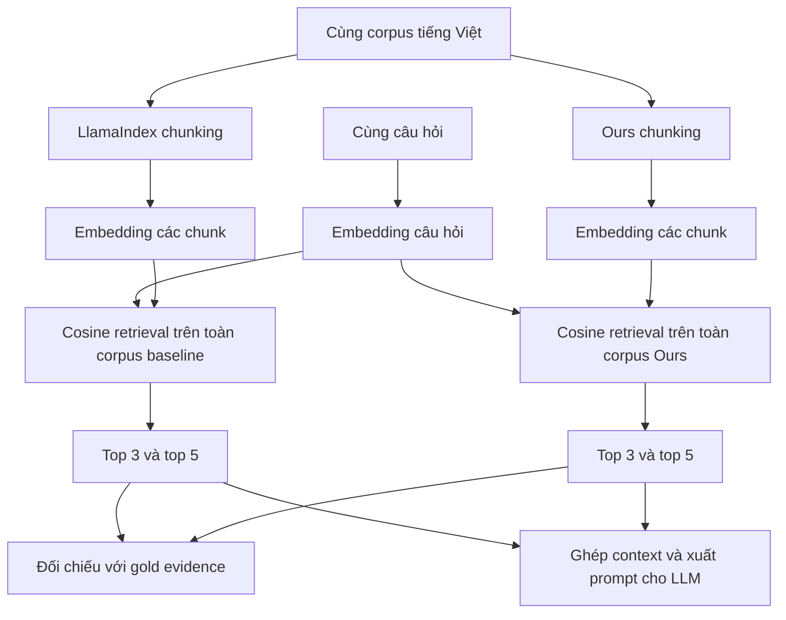

# RAG benchmark hiện tại: Max–Min vs Ours

Bộ đánh giá mở rộng đã có: [XQuAD tiếng Việt](data/benchmark/xquad_vi/README.md)
với 240 context, 1.190 câu hỏi, dev/test tách theo bài nguồn. Xem
[kết quả trên 957 câu test](data/benchmark/xquad_vi/RESULTS.md). Các bảng 16 câu
pilot bên dưới vẫn là dữ liệu cũ, không phải kết quả của bộ mới.

**Ollama local đã được nối:** `OllamaClient` mặc định dùng `qwen2.5:3b` tại
`http://localhost:11434`, temperature 0, max output 512 token.
Bạn tự khởi chạy Ollama. CLI mặc định vẫn chỉ retrieval; bật sinh câu trả lời bằng:

```powershell
.\venv\Scripts\python.exe evaluation/compare_rag.py --ollama
```

Có thể đổi địa chỉ qua `--ollama-url http://localhost:11434`. Hai chiến lược
dùng cùng client/config. Kết quả lưu thêm answer nhưng chưa chấm QA Accuracy.
Client dùng [Ollama Generate API](https://docs.ollama.com/api/generate), không stream.

Chạy từ thư mục project (không cần API key):

```powershell
.\venv\Scripts\python.exe -X utf8 evaluation/compare_rag.py
```

Khi đã activate môi trường: `python evaluation/compare_rag.py`.
Dependency retrieval nằm trong `requirements.txt`; không cần LlamaIndex cho lệnh mới.

## Pipeline dùng chung

`Document → injected chunker → chunks có document_id/chunk_id → shared MiniLM
→ in-memory NumPy cosine index → cùng query embeddings → top-k → prompt chung
→ LLMClient tùy chọn`.

- `src/rag/embedder.py`: tái sử dụng instance model của chunker, không load mỗi query.
- `src/rag/retriever.py`: cosine toàn corpus, xếp hạng ổn định theo thứ tự corpus khi hòa điểm.
- `src/rag/rag_pipeline.py`: index, retrieve, answer; chunker được inject từ ngoài.
- `src/rag/llm_client.py`: interface `generate(prompt)` và cấu hình model/temperature/max_tokens.
- `evaluation/evaluate_retrieval.py`: validation và chấm Recall@3/@5, MRR@5.
- `evaluation/compare_rag.py`: chạy Max–Min và Ours với cùng các thành phần phía sau.

Dùng lại 13 văn bản trong `data/test_case.json` và 16 câu hỏi trong
`data/benchmark/questions.json`. Không sao chép thành một corpus mới. Có thể truyền
`--documents data/benchmark/documents.json --questions <path>` cho corpus khác.
Documents có schema `[{"id": "doc_001", "text": "..."}]`; questions cần `id`,
`document_id`, `question`, `gold_evidence`; `gold_answer` không bắt buộc.

## Metric và tính công bằng

Evidence và chunk được chuẩn hóa Unicode NFC, casefold và khoảng trắng, rồi kiểm
tra substring ở đúng document. Một chunk trong top-k phải chứa đủ evidence;
không ghép các đoạn evidence rời nhau để tính HIT. Không dùng fuzzy matching.
Recall@k là tỷ lệ câu hỏi có HIT; MRR@5 là trung bình nghịch đảo thứ hạng HIT đầu
tiên trong top-5, hoặc 0 nếu không có. Gold chỉ được dùng sau retrieval để chấm.

Cả hai dùng cùng instance embedding, query embeddings được tính một lần, cùng
top-k (mặc định 5), cosine, corpus, prompt và cùng LLMClient nếu được inject.
`--top-k` phải >= 5; Recall/MRR vẫn chấm ở mốc 3/5, context dùng toàn bộ top-k.
Không thay tham số hay logic chunking. Cùng top-k không có nghĩa cùng lượng context;
JSON ghi cả độ dài context để đối chiếu. Độ dài đếm theo khoảng trắng, không gọi là
token của model. SentenceTransformer vẫn áp dụng giới hạn đầu vào của model khi
encode chunk; pipeline không tự chia lại chunk để tránh giới hạn đó.

Kết quả mới: `evaluation/results/rag_comparison.json` và `rag_comparison.csv`.
JSON có chunks, thứ hạng/score, prompt từng câu, chẩn đoán miss, cấu hình, hash đầu
vào/code và phiên bản package. Các file `chunker_comparison.*` là kết quả LlamaIndex cũ.

Thời gian tách chunking, embedding/index, retrieval ranking và query embedding
(tính một lần). Load/warmup model không tính vào indexing. Đây là một lần chạy,
có ảnh hưởng cache và thứ tự chạy; không phải kết luận thống kê về tốc độ.

## Kết quả chạy thực tế trên tập pilot hiện có

| Metric | Max–Min | Ours |
|---|---:|---:|
| Số chunk | 85 | 22 |
| Recall@3 | 62,5% | 75% |
| Recall@5 | 62,5% | 93,75% |
| MRR@5 | 0,5625 | 0,6448 |

Đây là dữ liệu phát triển nhỏ, có câu hỏi do trợ lý soạn; chưa phải tập test độc lập
được người rà soát. Nhãn chỉ chấp nhận nguồn đã chỉ định. Điểm không chứng minh
chất lượng đáp án LLM hay ưu thế tổng quát; evidence qua nhiều chunk vẫn bị tính miss.

## Nối LLM khi có model/credentials

Implement subclass `LLMClient`, thực hiện `generate(prompt)` với `self.config`,
rồi truyền cùng một instance vào `compare_rag(..., llm=client)` hoặc hai pipeline.
`GenerationConfig` cố định model, temperature và max_tokens. Benchmark lưu câu trả
lời thật khi có client; không có client thì chỉ xuất retrieval và prompt.
Không gửi request LLM mặc định và chưa tính QA Accuracy vì chưa có đáp án/rubric
được chuẩn bị. Unit test dùng fake client chỉ để kiểm tra wiring, không làm kết quả benchmark.

Kiểm thử:

```powershell
.\venv\Scripts\python.exe -X utf8 -m unittest discover -s tests
.\venv\Scripts\python.exe -X utf8 evaluation/evaluate_chunking.py
```

---

# Tài liệu lịch sử: LlamaIndex vs Ours

Phần bên dưới mô tả pipeline và kết quả cũ, không phải kết quả Max–Min.

Đã bổ sung bộ 16 câu hỏi mẫu có gold evidence và chạy cùng một retrieval pipeline
cho LlamaIndex SemanticSplitter và Ours. Mục tiêu là đo liệu chunking có giúp lấy
được chứng cứ cần thiết cho câu hỏi hay không.

## Chạy

Từ thư mục project, sau khi kích hoạt venv:

```powershell
python evaluation/compare_chunkers.py
```

Hoặc trên Windows không cần activate:

```powershell
.\venv\Scripts\python.exe evaluation/compare_chunkers.py
```

Không cần API key. Dùng model MiniLM đã cấu hình trong project, không thay đổi
thuật toán chunking, threshold hay model riêng cho từng phương pháp.

## Luồng xử lý



Gold evidence không tham gia encode câu hỏi, chọn chunk hay xếp hạng. Nó chỉ được
dùng sau retrieval để chấm kết quả. Prompt xuất ra chỉ có câu hỏi và các chunk
retrieved, không tự chèn câu trả lời chuẩn.

## Dữ liệu và cách chấm

[questions.json](data/benchmark/questions.json) chứa 16 câu hỏi do trợ lý soạn từ
nội dung sẵn có, trước khi xem điểm retrieval của chúng. Evidence được chép nguyên
văn. Đây là tập pilot trên dữ liệu phát triển, cần người rà soát trước khi dùng như
bộ đánh giá chính thức. Không phải câu hỏi lấy từ một benchmark công bố độc lập.

Mỗi câu có `id`, `document_id`, `question`, `gold_evidence`, `category`. Có câu hỏi
một câu, nhiều câu và dependency. Ví dụ câu hỏi về điều kiện xuất hiện phản ứng
bất thường dùng cả hai câu “Nếu ...” và “Thì ...” làm evidence.

```text
hit@k = 1 nếu có một chunk trong top-k:
        - thuộc đúng document_id đã gán nhãn;
        - chứa toàn bộ gold_evidence (chuẩn hóa khoảng trắng).
        Ngược lại = 0.

Recall@k = tổng hit@k / tổng số câu hỏi
```

Với một evidence mục tiêu mỗi câu hỏi, cách tính này cũng thường được mô tả là
tỷ lệ câu hỏi truy xuất trúng chứng cứ. Nó không phải điểm đúng/sai của câu trả lời
LLM. Hai chunk cộng lại đủ chứng cứ vẫn không đạt tiêu chí “một chunk chứa toàn bộ
evidence” đang dùng; cần hiểu điều này khi phân tích vai trò của overlap.

## Đọc kết quả

- [Bảng tổng hợp](evaluation/results/chunker_comparison.csv): Recall@3/@5 và metric boundary.
- [Chi tiết từng câu](evaluation/results/rag_questions.csv): bên nào hit/miss,
  lý do thất bại và lượng context được truy xuất.
- [Kết quả JSON](evaluation/results/chunker_comparison.json): đầy đủ nội dung top-5,
  cosine score, `rag_prompt_at_5` và metadata phục vụ tái lập.

`evidence_split` nghĩa là không có chunk nào chứa trọn đoạn evidence. Đây là lỗi
bảo toàn evidence theo tiêu chí của benchmark. `ranking_miss` nghĩa là chunk đủ
evidence tồn tại nhưng không lên top-5. Hai loại thất bại cần được phân tích riêng.

`evidence_preservation_rate` là tỷ lệ câu hỏi có ít nhất một chunk chứa trọn evidence
ở bất kỳ vị trí nào trong corpus. `mean_context_words_at_5` ghi lượng văn bản trung
bình của top-5 để thấy chi phí context, tính bằng đơn vị phân cách bởi khoảng trắng,
không phải token của LLM.

## Kết quả pilot đã chạy

| Metric | LlamaIndex | Ours |
|---|---:|---:|
| Recall@3 | 12/16 = 75% | 12/16 = 75% |
| Recall@5 | 13/16 = 81,25% | 15/16 = 93,75% |
| Evidence còn nguyên trong ít nhất một chunk | 15/16 | 16/16 |
| Độ dài context top-5 trung bình (đơn vị khoảng trắng) | 649,31 | 707,00 |

Các trường hợp đáng xem trong `rag_questions.csv`:

- `q010`: baseline chia evidence về cách dùng nhân sâm qua các chunk; Ours giữ
  được trọn evidence và truy xuất trong top-3.
- `q011`: cả hai có chunk chứa đủ evidence; Ours lấy được trong top-5, baseline
  không lấy được. Đây là khác biệt xếp hạng, không phải evidence bị phá vỡ.
- `q014`: baseline lấy được evidence BERT ở top-3, Ours chỉ lấy được ở top-5.
- `q004`: cả hai đều trượt top-5 dù chunk đủ evidence có tồn tại.

Chênh lệch Recall@5 là 12,5 điểm phần trăm, tương ứng 2 câu hỏi. Không nên suy ra
mức cải thiện ổn định trên corpus mới từ cỡ mẫu này. Context của Ours cũng dài hơn
trung bình khoảng 8,9%; kết quả tốt hơn đi kèm lượng văn bản truy xuất lớn hơn.

## Phần sinh câu trả lời

Hiện đã có retrieval và tạo context/prompt; **chưa gọi LLM sinh câu trả lời**.
Điều này đủ để so sánh Recall của hai chunker trong RAG, nhưng chưa đủ để kết luận
RAG đầu cuối trả lời chính xác hơn.

Nếu làm thí nghiệm generation tiếp theo, dùng `rag_prompt_at_5` của từng phương
pháp với cùng LLM, cùng cấu hình giải mã và cùng giới hạn context. Chấm câu trả lời
bằng đáp án chuẩn/rubric được chuẩn bị trước, đồng thời kiểm tra trích dẫn có hỗ trợ
câu trả lời không. Không dùng gold evidence để thay thế context truy xuất khi sinh
câu trả lời, vì như vậy sẽ che mất ảnh hưởng của chunking.

## Giới hạn khi đưa vào báo cáo

Corpus hiện có nhiều nội dung sức khỏe và Transformer giống nhau. Một chunk từ
document khác có thể trả lời được nhưng vẫn bị chấm miss vì nhãn chỉ chỉ định một
nguồn. Do đó điểm hiện tại là phép đo truy xuất **đúng nguồn đã gán nhãn**, không
phải đánh giá đầy đủ mọi chứng cứ hợp lệ.

Nên mở rộng corpus độc lập và đa dạng, rà soát nhãn, bổ sung mọi nguồn evidence
hợp lệ, giữ cấu hình cố định trên test. Cùng top-k cũng chưa đảm bảo cùng lượng
context: chunk lớn và overlap có thể tăng độ bao phủ lẫn chi phí. Kết quả pilot
không dùng để khẳng định Ours luôn tốt hơn.
