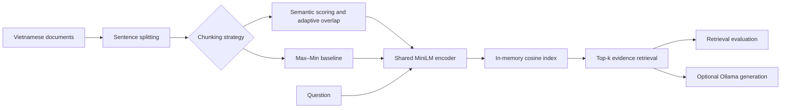

# Vietnamese Semantic Chunking for RAG

A Vietnamese NLP research project that combines semantic boundary scoring, sentence-linking rules, and adaptive context overlap to prepare documents for retrieval-augmented generation.

The project includes a configurable Streamlit demo, a reusable retrieval pipeline, and a controlled comparison with the Max–Min semantic chunker. On the original-context view of Vietnamese XQuAD, the proposed method reaches **91.85% Evidence Recall@5**, compared with **86.94%** for Max–Min. The comparison also reports the long-document setting, where Max–Min performs better.

**Stack:** Python · Sentence Transformers · PyTorch · NumPy · Streamlit · Ollama

[Quick start](#quick-start) · [Benchmark results](#benchmark-results) · [Run the benchmark](#run-the-benchmark) · [Documentation](#documentation)

## Why this project

Splitting documents at arbitrary positions can separate an answer from its supporting context. For Vietnamese, expressions such as “nếu–thì” and “tuy–nhưng” provide additional clues that adjacent sentences belong together.

This project explores how those clues can complement multilingual sentence embeddings and chunk-length preferences. It evaluates both evidence retrieval and context cost, so improvements can be assessed alongside the amount of text returned to the generator.

## Features

- **Semantic boundary scoring:** combines local changes in cosine similarity, a chunk-length score, and a penalty for matched Vietnamese sentence-linking patterns.
- **Adaptive overlap:** carries zero, one, or two trailing sentences into the next chunk based on similarity across the boundary.
- **Controlled baseline comparison:** adapts Max–Min to the same sentence splitter, encoder, corpus, and cosine retriever.
- **Interactive RAG demo:** compares chunkers, adjusts parameters, inspects retrieved evidence, generates answers through local Ollama, and exports session results as JSON.
- **Reproducible evaluation:** stores per-question rankings, failure diagnoses, configurations, input/source hashes, and paired bootstrap summaries.

## How it works



The proposed chunker scores eligible boundaries in the long-text branch using:

```text
score = 0.5 × semantic_score + 0.3 × size_score − 0.6 × linking_risk
```

Current defaults use minimum/target/maximum lengths of **120/180/240 whitespace-separated units**, a raw semantic-drop threshold of **0.30** for optional cuts, and overlap thresholds of **0.30/0.55**. These lengths are distinct from model tokens; the final chunk may exceed the maximum after overlap or when no eligible boundary exists.

The semantic/size ratio was selected within a 54-configuration weight grid, part of a 180-configuration development study. The risk penalty was retained among tied values; the study does not establish every default as optimal. See the [method](docs/METHOD.md) and [parameter evidence](THAM_SO_VA_MINH_CHUNG.md).

## Quick start

The project has been run with **Python 3.13.5 on Windows**. Run the following commands from the repository root in PowerShell:

```powershell
python -m venv .venv
.\.venv\Scripts\python.exe -m pip install -r requirements-gui.txt
.\.venv\Scripts\python.exe -m streamlit run streamlit_app.py --server.address 127.0.0.1
```

Open **http://localhost:8501**, paste Vietnamese text, choose a chunking strategy, and build the index. Inspect the resulting chunks before querying them. The first model load downloads `sentence-transformers/paraphrase-multilingual-MiniLM-L12-v2`; subsequent runs can use the local cache. Core chunking and retrieval do not require an API key or a running LLM service.

For answer generation, run Ollama locally with the **`qwen2.5:3b`** model available at **http://localhost:11434**. The app calls it when you click **Trả lời**. It uses temperature `0` and an output limit of `512` tokens. The app does not start Ollama or download the generation model.

On macOS/Linux, create the environment with `python3 -m venv .venv` and replace `.\.venv\Scripts\python.exe` with `.venv/bin/python`. These commands have not been validated on those platforms.

## Benchmark results

Evaluation uses a local retrieval adaptation of **Vietnamese XQuAD**: 1,190 questions from 240 contexts across 48 source titles. A title-disjoint split assigns 233 questions to development and **957 questions from 38 source titles** to evaluation.

Both methods use the same multilingual MiniLM encoder and corpus-wide cosine retrieval. The two input views contain the same questions and source content; they are alternative document organizations, rather than independent datasets.

| Input view               | Method   | Chunks | Evidence Recall@5 |            MRR@5 |
| ------------------------ | -------- | -----: | ----------------: | ---------------: |
| Original contexts        | Max–Min |    583 |            86.94% |           0.7421 |
| Original contexts        | Proposed |    226 |  **91.85%** | **0.8057** |
| Same-title concatenation | Max–Min |    556 |  **85.27%** | **0.7259** |
| Same-title concatenation | Proposed |    191 |            80.67% |           0.6553 |

The proposed method improves Recall@5 by **4.91 percentage points** on original contexts and trails by **4.60 points** on concatenated documents. Its average top-5 context is approximately **2.17×** and **2.52×** larger, respectively. Results are from the current `0.5/0.3/0.6` configuration.

**Scope of the results:** Evidence Recall@5 measures whether one of the top five chunks contains the complete labeled evidence from the correct document. Evidence labels are derived automatically from source answers. This benchmark evaluates retrieval; generated-answer quality has not been scored. The encoder input limit is 128 model tokens, and many proposed chunks exceed it. Earlier test results had already been inspected before the development study, so these runs require confirmation on a new corpus.

Sources: [verified metrics](evaluation/results/scientific_paper_current/metrics_verified.csv), [run protocol](evaluation/results/scientific_paper_current/protocol.json), [token diagnostics](evaluation/results/scientific_paper_current/tokenizer_summary.csv), and [full experiment guide](docs/EXPERIMENTS.md).

## Run the benchmark

For retrieval-only use, install `requirements.txt` instead of the GUI requirements. The GUI installation above already includes the core dependencies.

Use explicit dataset paths and a new output directory:

```powershell
.\.venv\Scripts\python.exe -X utf8 evaluation/compare_rag.py --documents data/benchmark/xquad_vi/paragraph/test/documents.json --questions data/benchmark/xquad_vi/paragraph/test/questions.json --output-dir evaluation/results/local_paragraph_test
```

Replace `paragraph` with `article` and choose another output directory to evaluate concatenated documents. Running the CLI without dataset arguments uses the small development pilot.

Each run writes `rag_comparison.json` and `rag_comparison.csv`, including aggregate metrics and per-question retrieval details. Add `--ollama` to generate answers through the local service; answer quality is not scored automatically. A complete two-method test run would issue 1,914 generation requests.

See [experiment instructions](docs/EXPERIMENTS.md) for bootstrap summaries, the development sensitivity study, and the archived pilot experiments.

## Use the chunker in Python

Run from the repository root:

```python
from pathlib import Path
import sys

sys.path.insert(0, str(Path.cwd() / "src"))
from semantic_chunker import semantic_chunk

text = (
    "Chia tài liệu thành các đoạn giúp hệ thống lập chỉ mục nội dung. "
    "Mỗi đoạn cần giữ đủ ngữ cảnh để biểu diễn thông tin liên quan. "
    "Người dùng có thể truy xuất các đoạn bằng một câu hỏi tiếng Việt."
)
chunks: list[str] = semantic_chunk(text)
for index, chunk in enumerate(chunks, start=1):
    print(f"Chunk {index}: {chunk}")
```

The function returns an ordered `list[str]`. Short inputs may remain a single chunk. The retrieval pipeline accepts an injected chunker, making it possible to compare strategies while sharing the downstream encoder and retriever.

## Validation

The full test suite includes the historical LlamaIndex adapter. Install its optional dependency before running all tests:

```powershell
.\.venv\Scripts\python.exe -m pip install -r requirements-benchmark.txt
.\.venv\Scripts\python.exe -X utf8 -m unittest discover -s tests
```

Tests cover boundary scoring, overlap behavior, baseline decisions, retrieval matching, configuration isolation, dataset integrity, and the Ollama adapter. Historical pilot expectations and their known differences from the current configuration are documented in the [experiment guide](docs/EXPERIMENTS.md).

## Project structure

```text
src/                         Proposed chunker and reusable RAG components
baselines/                   Max–Min and historical LlamaIndex adapters
gui/                         Per-session chunker configuration
evaluation/                  Benchmark, metrics, and sensitivity study
evaluation/results/          Saved results and provenance
data/benchmark/              Pilot data and Vietnamese XQuAD adaptation
tests/                       Unit tests
scripts/                     Dataset, evidence, and manuscript utilities
docs/                        Method, experiment guide, and archived notes
streamlit_app.py             Interactive application
BAO_CAO.md                   Vietnamese scientific manuscript source
THAM_SO_VA_MINH_CHUNG.md      Detailed parameter evidence
```

## Documentation

- [Method and baseline](docs/METHOD.md) — algorithm, active parameters, and implementation details.
- [Experiments and reproducibility](docs/EXPERIMENTS.md) — datasets, commands, current artifacts, and interpretation.
- [Scientific manuscript in Vietnamese](BAO_CAO.md) · [Word manuscript](docs/report/Bao_Cao.docx).
- [Parameter evidence](THAM_SO_VA_MINH_CHUNG.md) — weight search, thresholds, ablations, and limitations.
- [Dataset documentation](data/benchmark/xquad_vi/README.md) — source, split, schema, and annotation limitations.
- [Historical experiments](docs/archive/README.md) — earlier baselines and results retained for traceability.

## Author and attribution

**Vương Đức Hùng** — sole developer.  
Faculty of Information Technology, University of Transport and Communications.

The Max–Min baseline follows Kiss, Nagy, and Szilágyi, *Max–Min semantic chunking of documents for RAG application* (2025); its implementation reference is documented in the [method guide](docs/METHOD.md). Vietnamese XQuAD source data and the local conversion are distributed under **CC BY-SA 4.0**; see the [dataset attribution](data/benchmark/xquad_vi/README.md) and [license text](data/benchmark/xquad_vi/source/CC-BY-SA4.0.txt).
